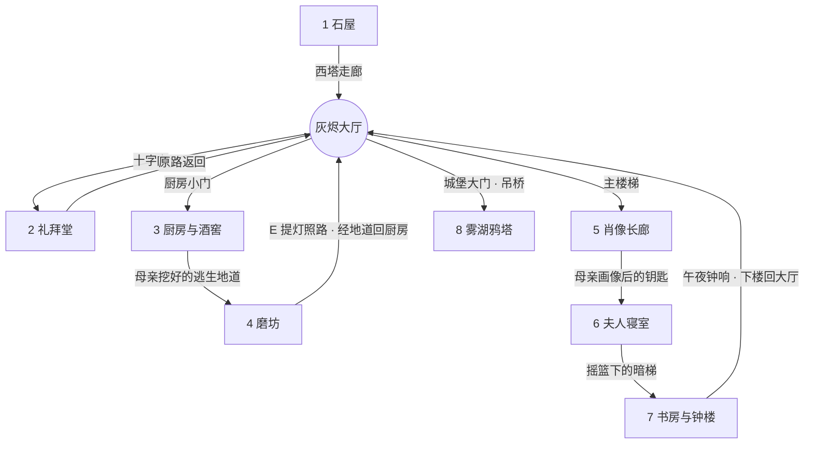

# 《迷雾城堡》完整版策划案（8 关 + 枢纽大厅 · GDD v1.1）

> 类型：点击式解谜逃脱（锈湖 / Cube Escape like）
> 基底：已完成的第 1 关 Demo（`index.html`），本案在其基础上扩展为 8 关完整故事
> 状态：**纯策划文档，暂不落地开发**
> 工作目录：`/Users/giggle/Desktop/vibe coding/迷雾城堡-锈湖like`（游戏 `index.html`、本策划案、`参考图/`、后续美术素材均在此）

**版本记录**

| 版本 | 日期 | 变更 |
|---|---|---|
| v1.0 | 2026-10-13 | 8 关完整策划 |
| v1.1 | 2026-10-14 | 新增枢纽场景「灰烬大厅」（2.5）；调整 L1 / L2 / L4 / L7 的出入口；补充鸦羽回补规则；新增第 10 章「美术资源与人物素材」 |
| v1.2 | 2026-10-14 | 人物造型定为方案 A「全员人类」（10.4）；新增参考图需求清单（10.6） |

---

## 目录

1. 故事圣经（世界观 / 人物 / 时间线 / 核心秘密）
2. 整体结构（关卡地图 / 叙事节拍 / 难度曲线 / **灰烬大厅**）
3. 跨关系统（记忆书页 / 隐藏鸦羽 / Details 面板 / 符号词典）
4. 八关详细设计
5. 跨关联动总表（道具流转 / 线索回收）
6. 结局设计
7. 提示与容错
8. 对第 1 关 Demo 的改动清单
9. 落地开发建议
10. 美术资源与人物素材

---

## 1. 故事圣经

### 1.1 一句话梗概

> 中世纪英格兰乡间，一座被雾沼环绕的小城堡里，**雷文霍尔德家族每隔 33 年就会少一个 7 岁的孩子**。
> 你在一间上锁的石屋里醒来——直到第五关你才会发现，**画布下被涂掉的那个孩子，就是你自己。**

### 1.2 世界观

| 项 | 设定 |
|---|---|
| 地点 | 英格兰北部乡间 · 灰麦村（Greywheat）· 雾湖畔的小城堡 **雷文霍尔德堡（Ravenhold）** |
| 当前时间 | **1448 年 · 秋 · 收获月之夜**（玩家要到第 7 关才确认“现在是哪一年”） |
| 核心秘密 | 1316 年大饥荒，先祖 **阿尔德里克** 与雾中的“乌鸦”立约：每 33 年献出一名 7 岁的雷文霍尔德血脉孩子，换来麦田丰收、瘟疫绕行。阿尔德里克死后，**自己化成了那只乌鸦**，靠孩子们的“年岁”永生。 |
| 超自然规则 | 被献出的孩子会成为困在城堡里的“回声”；每逢献祭之夜，回声会重演那一夜。 |
| 基调 | 不血腥，靠暗示：被刮掉的名字、涂掉的画像、空着的面粉袋、只剩一只的小鞋 |

### 1.3 人物

| 人物 | 身份 | 1415 年那一夜做了什么 | 1448 年状态 | 象征 |
|---|---|---|---|---|
| **玛格丽 Margery**（玩家） | 领主幼女，1408 年生 | 被锁在石屋，午夜被带到雾湖 | 回声 / 幽灵，每 33 年醒来一次 | 木鹿玩具 |
| **伊莎贝拉 Isabel** | 领主夫人，娘家哈特维尔（Hartwell，家徽是**雄鹿**） | 给全城堡的麦酒下安眠药；拆走钟楼齿轮让午夜钟不响；安排磨坊马车接走女儿 | 第二年春天走进雾湖，已故 | 雄鹿 · 摇篮曲 |
| **奥斯瓦尔德 Oswald** | 老领主 | 亲手把女儿送到湖边 | 已故 | 鸦戒 |
| **埃德蒙 Edmund** | 长子，1403 年生（当年 12 岁） | 没喝麦酒，向父亲告密（怕下一个是自己） | 现任领主，45 岁，终身愧疚 | 刻 “E” 的提灯 |
| **艾格尼丝 Agnes** | 埃德蒙之女，1441 年生 | — | **今晚就满 7 岁 → 本轮祭品** | 空白画布 |
| **安塞姆神父 Anselm** | 城堡礼拜堂神父 | 在湖边为孩子行终傅礼，事后刮掉了她的受洗名 | 已故，留有忏悔纸卷 | 圣铃 |
| **玛莎 Martha** | 厨娘 | 照夫人吩咐下药 | 老迈，睡在灶边（会说梦话，承担提示功能） | 陶罐 |
| **磨坊主汤姆 Tom** | 村民 | 赶着马车在磨坊等到天亮 | 已故 | 面粉袋 |
| **乌鸦 / 阿尔德里克** | 先祖，契约本体 | — | 栖在雾湖鸦塔，等待今晚 | 红眼 · SITIO（我渴） |

### 1.4 家族树（玩家在游戏中逐步补全）

```
阿尔德里克（立约者，1316）
 └─ 奥尔温 Aldwin  1309–1316 ✝  ← 第一个孩子（大饥荒）
     ……
 └─ 塞西莉 Cecily  1342–1349 ✝  ← 黑死病那年，灰麦村无人染病
     ……
 └─ 休 Hugh        1375–1382 ✝
     ……
奥斯瓦尔德 ═ 伊莎贝拉（哈特维尔家，雄鹿）
 ├─ 埃德蒙 Edmund  1403–
 │    └─ 艾格尼丝 Agnes 1441–  ← 今晚
 └─ 玛格丽 Margery 1408–1415 ✝  ← 你
```

> 规律：**出生年 + 7 = 献祭年，献祭年间隔 33 年**（1316 / 1349 / 1382 / 1415 / **1448**）

### 1.5 1415 年“最后一夜”时间线（第 8 关排序谜题的标准答案）

| 序 | 月亮位置 | 事件 | 对应记忆页 |
|---|---|---|---|
| 1 | 刚升起（东方地平线） | 母亲在石屋给玛格丽唱摇篮曲 | ⑥ 母亲的摇篮曲 |
| 2 | 低空 | 父亲锁上石屋门 | ① 被锁的夜 |
| 3 | 半空 | 母亲在麦酒里下安眠药 | ③ 母亲的药 |
| 4 | 中天（午夜前） | 埃德蒙敲开父亲的门告密 | ⑦ 哥哥的告密 |
| 5 | 过中天 | 神父在湖边行终傅礼 | ② 被抹去的名字 |
| 6 | 西沉 | 磨坊主在马车边等到绝望 | ④ 没有到来的马车 |
| 7 | 落下（黎明） | 画师涂掉画像里的孩子 | ⑤ 画布下的孩子 |

---

## 2. 整体结构

### 2.1 关卡地图与通路（每一关的出口都有剧情理由）



- 共回大厅 **4 次**（L1、L2、L4、L7 之后）。
- 二层 **L5 → L6 → L7 连续进行，中途不回大厅**：这三关是情绪最集中的一段（发现自己是谁 → 母亲的真相 → 契约的真相），中途切回会打断节奏。
- 大厅的完整设计见 **2.5**。

> 彩蛋：第 1 关门锁答案 **月 · 十字 · 乌鸦** 本身就是整条路线的预言——收获**月**照着的大厅 → **十字**（礼拜堂）→ 最终抵达**乌鸦**之塔。大厅拱顶上刻着这句预言，第一次进大厅就要用到它（见 2.5.4）。

### 2.2 叙事节拍与情绪曲线

| 关 | 揭示 | 玩家情绪 |
|---|---|---|
| 1 | 我被锁住了；有人留了逃生线索；“别相信那只乌鸦” | 困惑 |
| 2 | 家族受洗册上有好几个名字被刮掉了 | 好奇、不安 |
| 3 | 母亲那一夜在策划救人 | 温情 |
| 4 | 马车没等到孩子；埃德蒙的提灯掉在这里 | 怀疑 |
| 5 | **被涂掉的孩子是我**；空白画布写着 1448 | **震撼（中段反转）** |
| 6 | 母亲留下了第 1 关的线索；她已走进湖里 | 悲伤 |
| 7 | 契约全文；乌鸦就是阿尔德里克；契约有隐藏解除条款；今晚是 1448 | 愤怒、决心 |
| 8 | 用这一路收集的一切，打破契约 | 释放、抉择 |

### 2.3 难度曲线

| 关 | 难度 | 步骤数 | 并行线 | 跨关继承 | 新机制 | 预计时长 |
|---|---|---|---|---|---|---|
| 1 石屋 | ★ | 9 | 1 | 0 | 点击 / 物品使用 / 特写 | 4 min |
| 2 礼拜堂 | ★★ | 10 | 2 | 1 | 光色滤读 + 音名拼词 | 6 min |
| 3 厨房 | ★★☆ | 12 | 2 | 3 | 道具合成 + 倒水量取 + 听声计时 | 8 min |
| 4 磨坊 | ★★★ | 11 | 2 场景 | 2 | 场景切换 + 齿轮奇偶 | 9 min |
| 5 长廊 | ★★★ | 8 | 1 | 2 | 观察断代 + 排序推理 + 侧光 | 8 min |
| 6 寝室 | ★★★★ | 11 | 双世界 | 3 | 镜中世界 + 左右反转 | 10 min |
| 7 书房钟楼 | ★★★★ | 12 | 2 场景 | 4 | 推算 + 镜像阅读 + 机关联动 | 12 min |
| 8 鸦塔 | ★★★★★ | 15 | 4 阶段 | 8+ | 综合 + 限时 + 抉择 | 15 min |
| 灰烬大厅（枢纽） | ★ ~ ★★ | 每次 1–2 | 1 | 每次 1 | 门锁继承 + 座次推理 | 每次 ≤ 1 min |

**难度设计原则**

- **每关只新增一种核心机制**，并在后续关卡用“变体”复用（如倒水 → 第 8 关再次喂乌鸦）。
- 前 3 关的线索都在本关内；第 4 关起开始需要“回忆前关”；第 7、8 关大量回收。
- Details 面板会保留所有关键线索缩略图，**回忆题永远可以查证**，避免“考记忆力”。

### 2.4 每关的“巧妙感”核心（Aha 时刻）

| 关 | Aha |
|---|---|
| 1 | 「天空的眼泪」就是窗外的雨——隐喻被字面化 |
| 2 | 乐谱即密码：音名 F-A-D-E-D 拼出 “FADED（褪去）”——正是被刮掉的名字 |
| 3 | 第 1 关的圣杯恰好是 **3 勺**，成了量水谜题的关键量具；敲酒桶听出空心 |
| 4 | 齿轮数量的奇偶决定磨盘转向：**逆时针磨出过去，顺时针磨出未来** |
| 5 | 画作没有年份？看**窗外那棵橡树**从树苗长成大树——然后看见自己的脸 |
| 6 | 镜子里的音乐盒是对的，但**照抄会错**——镜像是左右反的；母亲的刺绣就是第 1 关吊灯的答案 |
| 7 | 契约背面的镜像小字是**解除条款**；鸦笼密码锁要求你算出“今年” |
| 8 | 记忆的**收集顺序 ≠ 发生顺序**，要按每页画中**月亮的位置**排序；第 1 关“喂乌鸦喝水”在终局重演，这次水里有母亲的药 |
| 大厅 | 每次回来，长餐桌上都多出一件东西；它们看起来只是摆设，其实是上楼谜题的线索：**唯一满着的那杯酒，就是那一夜唯一没睡着的人** |

### 2.5 灰烬大厅（The Great Hall · 枢纽场景）

#### 2.5.1 定位

| 项 | 内容 |
|---|---|
| 作用 | 串起城堡各区域的“轻中转”：**只有一个场景，门按顺序解锁**，不做开放式选关地图 |
| 参考 | 《Rusty Lake Hotel》的餐厅 / 走廊、《Rusty Lake Paradise》的岛屿 |
| 设定 | 1415 年收获节晚宴的大厅。那一夜之后再没人用过，餐桌和 8 把椅子保持原样，积满灰烬 |
| 核心体验 | ① 有一个可以“回来”的地方，玩家会觉得自己在一座城堡里，而不是在一关接一关地过 ② 大厅本身就是进度条 ③ 回补鸦羽、查阅线索的入口 |
| 时长 | 每次停留 ≤ 1 分钟；新增互动每次最多 1 个 |

#### 2.5.2 场景布局

| 位置 | 物件 | 通往 / 作用 |
|---|---|---|
| 左侧拱门 | 刻 ✝ 的木门，门上一个单符号转盘 | **L2 礼拜堂** |
| 左下 | 厨房小门（挂着陶罐，门缝里能看到门闩） | **L3 厨房与酒窖**（L4 磨坊经地道从这里进出） |
| 中央后方 | 主楼梯 + 铁栅门；平台上挂着一幅被布盖住的大画 | **二层：L5 → L6 → L7** |
| 右侧 | 城堡大门，横着粗铁门闩，门缝外是雾 | **L8 雾湖鸦塔**（吊桥放下后） |
| 中央 | 长餐桌 + 8 把椅子（见 2.5.3） | **进度展示 + 座次谜题** |
| 壁炉上方 | 家族树挂毯，名字随剧情逐个浮现 | 家族树查阅 |
| 壁炉台 | 7 个羽毛槽的木架 | **鸦羽收集架**，空槽提示哪一关还漏了 |
| 窗 | 收获月 | 月亮随进度从东方升到中天，进入 L8 前开始西沉 |
| 角落 | 刻度蜡烛钟（8 格） | 剧情时钟，每通一关烧掉一格；最后一格对应 L8 的月落限时 |
| 拱顶 | 石刻铭文「月照之厅 · ？ · 鸦之高塔」，中间的符号被凿掉了 | 第一次进大厅的门锁线索 |

> 1448 年的城堡里还没有机械落地钟，所以用刻度蜡烛钟，更贴合中世纪。

#### 2.5.3 长餐桌与 8 把椅子

1415 年收获节，按乡间习俗，领主请神父、磨坊主和厨娘同桌吃饭。椅背各有一个镂空雕花：

| 座位 | 椅背雕花 | 主人 |
|---|---|---|
| 主位 | 乌鸦 | **先祖之席**：永远空着，“留给守望者” |
| 主位右 | 塔楼 | 奥斯瓦尔德（父亲） |
| 主位左 | 雄鹿 | 伊莎贝拉（母亲） |
| 右 2 | 盾牌 | 埃德蒙 |
| 左 2 | 小鹿（**椅腿被锯短**） | 玛格丽 |
| 右 3 | 十字 | 安塞姆神父 |
| 左 3 | 麦穗 | 磨坊主汤姆 |
| 末位 | 陶罐 | 厨娘玛莎 |

#### 2.5.4 随进度的变化与互动

| 回到大厅时（已通关） | 餐桌上的变化 | 其他变化 | 本次互动（解锁下一处） |
|---|---|---|---|
| **L1** | 短椅前出现一只空木碗 | 蜡烛钟第 1 格熄灭；月亮刚升起 | **十字门（★）**：拱顶铭文「月照之厅 · ？ · 鸦之高塔」缺了中间一个符号。玩家想起第 1 关门锁是 **月 · 十字 · 乌鸦** → 把门上转盘拨到 ✝ → 礼拜堂门开 |
| **L2** | 神父座位上出现一本合上的祈祷书 | 挂毯浮现 1309、1342、1375 三个年份（名字被刮） | **厨房小门（★）**：门从里面闩着，门缝太窄伸不进手 → 用 L2 拿到的**灭烛钩**从门缝挑起门闩 |
| **L4**（含 L3） | 每个座位前都多了一只麦酒杯，**只有一只是满的**（在盾牌椅前）；麦穗椅上多了一只空面粉袋 | 主楼梯铁栅门出现一个提灯挂钩 | **主楼梯（★★ 座次推理）**：栅门上刻着「那一夜，唯一清醒的人为父亲提着灯。把灯还给他。」→ 玩家要想到 L3 的线索：全城堡只有埃德蒙没喝麦酒 → 满着的那杯就是他的 → 把 **E 提灯**放在盾牌椅上 → 灯光穿过椅背镂空，在栅门上投出一个钥匙孔形光斑，栅门打开。放错椅子：光斑落在墙上，形状不对 |
| **L7**（含 L5、L6） | 雄鹿椅上多了一支湿透的雄鹿发簪；**先祖之席的椅子转了过来，正对着城堡大门** | 楼梯平台那幅画的布滑落：是埃德蒙和艾格尼丝的新画像，**艾格尼丝的脸刚被涂上一层未干的黑颜料**（记忆页 ⑤ 正在今晚重演）；大门铁闩被午夜钟震断；月亮过中天 | **城堡大门（无谜题）**：门开前会检查鸦羽架，有空槽时窗外乌鸦叫一声，字幕「壁炉台上还空着 N 个位置。」进入 L8 后不能再回来 |
| **结局** | 结局二：短椅上坐着艾格尼丝；结局三：除先祖之席外 7 把椅子都坐上了回声，先祖之席被搬走 | — | — |

#### 2.5.5 规则

1. **任何时候只有一扇“新”门在发光**；其余门要么锁着，要么是已完成的关卡。
2. 已完成的关卡可以从大厅重新进入，用于**回补鸦羽**；回去后谜题保持已解状态，只保留鸦羽和风味互动。
3. 二层（L5–L7）完成后，主楼梯可以直接走到任意一个二层房间。
4. 进入 L8 前有一次确认（见 2.5.4），之后不能返回。
5. 大厅的所有变化都由全局状态（`G.progress`、`G.feathers`、`G.memories`）派生，只做显示 / 隐藏，不需要每次重画场景。

---

## 3. 跨关系统

### 3.1 记忆书页（主线收集）

- 第 1 关桌上那本书，在游戏中升级为 **《家族之书》**，空白页会随剧情自动浮现插画。
- 每关最后一步触发一段“回声”剪影动画（1415 年那一夜的片段），随后该画面被印进书里，成为一页记忆。
- 每页插画角落都画着**窗外的月亮**——这是第 8 关排序的唯一依据，玩家前 7 关不会察觉其意义。

| 页 | 来源关 | 标题 | 画面 | 月亮位置 |
|---|---|---|---|---|
| ① | 1 | 被锁的夜 | 父亲的背影在门外落锁 | 2 |
| ② | 2 | 被抹去的名字 | 神父在湖边举着十字架 | 5 |
| ③ | 3 | 母亲的药 | 母亲往麦酒桶里倒药瓶 | 3 |
| ④ | 4 | 没有到来的马车 | 磨坊主坐在马车边，灯快灭了 | 6 |
| ⑤ | 5 | 画布下的孩子 | 画师举着刷子涂抹画布 | 7 |
| ⑥ | 6 | 母亲的摇篮曲 | 母亲坐在石屋床边唱歌 | 1 |
| ⑦ | 7 | 哥哥的告密 | 少年举着提灯敲父亲的门 | 4 |

### 3.2 隐藏鸦羽（可选收集 · 决定真结局）

每关 1 根，共 7 根。全部集齐 → 第 8 关解锁真结局「她的名字」。

| 关 | 藏匿位置 | 发现方式 |
|---|---|---|
| 1 | 吊灯铁环上方 | 4 支蜡烛点亮后才看得见阴影里的羽毛 |
| 2 | 钟绳顶端 | 拉钟 3 次，乌鸦惊飞后落下 |
| 3 | 灶台烟囱 | 熄灭灶火后伸手进烟道 |
| 4 | 麦田里 | 圣铃驱散鸦群后，田垄间留下一根 |
| 5 | 盔甲头盔里 | 掀开护面 |
| 6 | 床上枕头下 | 镜中世界里枕头是歪的，把现实中的枕头摆成同样位置 |
| 7 | 钟楼大钟内壁 | 午夜钟响后，钟锤下落时露出 |

**回补规则（v1.1 新增）**

- 每回到大厅一次，已拿到的鸦羽会自动插进壁炉台的收集架；空槽下方刻着对应房间的小图标，提示漏在哪一关。
- 已完成的关卡可以从大厅重新进入补拿（见 2.5.5），进入 L8 后不能再补。

### 3.3 Details 面板升级

- 每关 8 格，沿用第 1 关样式（缩略图 + ✓ + In hand 角标）。
- 新增顶部页签：**物品 / 线索 / 家族树**。
  - 物品：可跨关携带的道具（最多同时持有 6 件）
  - 线索：本关及前关的关键画面缩略图（可点开重看，解决“回忆题”）
  - 家族树：随剧情补全名字与年份，被刮掉的名字显示为 `M—— 1408–?`

### 3.4 符号词典（贯穿全作）

| 符号 | 含义 | 出现位置 |
|---|---|---|
| ☀ 日 | 丰收 / 契约的回报 | 1 门轮盘、2 彩窗、7 契约 |
| ☾ 月 | 收获月之夜 / 时间 | 1 门轮盘、2 彩窗、每页记忆、7 月相盘、8 排序 |
| ✝ 十字 | 礼拜堂 / 终傅礼 | 1 门轮盘与椅背、2 全关 |
| 🐦 乌鸦 | 阿尔德里克 / 契约 | 全作 |
| 🦌 雄鹿 | 母亲（哈特维尔家） | 1 挂毯、2 洗礼池、4 木鹿、6 刺绣 |
| 👁 眼 | 乌鸦在看着你 | 1 地毯、5 画像眼睛、8 祭坛地面 |
| SITIO | 拉丁文“我渴”——乌鸦的渴求 | 1 乌鸦底座、8 祭坛 |

---

## 4. 八关详细设计

> 统一格式：概要 / 剧情节拍 / 场景物件 / 继承与产出 / 谜题链（含答案）/ 巧思 / 失败反馈 / 隐藏鸦羽 / 三级提示

---

### 第 1 关 · 石屋（The Stone Room）— 已完成 Demo

| 项 | 内容 |
|---|---|
| 位置 | 西塔底层，关押“被选中孩子”的房间 |
| 难度 | ★ 教学关 |
| 新机制 | 点击查看、特写交互、持有物使用 |

**剧情节拍**：你在陌生石屋醒来，门被三个铁轮锁死。屋里的一切像是有人**特意为你留下的**逃生路线。

**谜题链**（与现有 Demo 一致）

1. 读书：「乌鸦口渴了。把天空的眼泪给它，它便交出所守护之物。」
2. 拿圣杯
3. 拔窗插销开窗，持杯接雨水
4. 把雨水倒在乌鸦（底座 SITIO）喙下 → 钥匙掉落
5. 拾钥匙，开箱，得字条：吊灯草图「如同最后一夜那样燃烧 · four flames, no more」
6. 点亮吊灯 **I、III、IV、VI** 四支（点满 6 支会被冷风吹灭）
7. 房间变亮，掀开挂毯右下翘角 → 墙上刻着 **月、十字、乌鸦**
8. 门上三铁轮转为 月 / 十字 / 乌鸦，拉门环 → 逃脱
9. 门外是西塔的短走廊，尽头通向**灰烬大厅**（v1.1 修改）

**产出**：圣杯（持有，第 3、8 关）· 记忆页 ① · 烧焦纸片「……别相信那只乌鸦。」（第 6 关补全）· 门锁答案「月 · 十字 · 乌鸦」（大厅十字门）
**隐藏鸦羽**：吊灯铁环上方（点亮后可见）
**埋下的伏笔**（对玩家而言此时只是风味文本）

- 书架上的空药瓶，瓶底刻着 **H** → 第 3 关揭示：是母亲的安眠药瓶
- 雄鹿挂毯 → 母亲娘家家徽
- 吊灯点灯规律 → 第 6 关揭示：母亲刺绣里的图案，字条是她写的
- 地毯中央“睁着的眼睛” → 第 8 关祭坛地面同款纹样

---

### 第 2 关 · 礼拜堂（The Chapel）

| 项 | 内容 |
|---|---|
| 位置 | 城堡东侧小礼拜堂，深夜，月光 |
| 难度 | ★★ |
| 新机制 | **光色滤读**（彩窗光只照亮同色字迹）+ **音名拼词**（乐谱即密码） |
| 时长 | 约 6 分钟 |

**剧情节拍**：受洗册上，雷文霍尔德家每隔几十年就有一个孩子的名字被刮掉。最近被刮掉的那个，只剩一个 “M”。

**场景物件**

- 四扇彩窗（日 · 月 · 鹿 · 鸦），各有木百叶，初始全关，堂内昏暗
- 圣诗板（墙上挂的木板，用来写当日诗歌编号，上面布满层叠的彩色粉笔划痕）
- 小管风琴：7 个琴键 A–G、7 根音管、一根风箱拉杆、气压表
- 洗礼池（干涸，池底有铅塞，侧面刻雄鹿）
- 告解室（隔窗紧闭）
- 圣器柜（上锁，没有锁孔，只有一排音管装饰）
- 钟绳（垂在高处）
- 祭坛：烛台、灭烛钩

**入口**：大厅十字门（用第 1 关门锁答案的中间符号 ✝ 打开，见 2.5.4）
**继承**：第 1 关门锁答案「月」——月窗是本关正解（作为提示方向，不强制）
**产出**：圣铃（第 3、4、8 关）· 洗礼册残页（第 3、5 关）· 灭烛钩（本关 + 大厅厨房门）· 记忆页 ②

**谜题链**

| 步 | 操作 | 结果 |
|---|---|---|
| 1 | 依次打开四扇彩窗百叶 | 每扇窗的光投在圣诗板上，只有同色字迹清晰：黄光读出 `BEG`、红光读出 `DEAF`、蓝光（月窗）读出 `FADED`、鸦窗是黑玻璃不透光 |
| 2 | 祭坛上的神父手记 | 「唯有月光能读出她的名。」→ 确认答案是蓝光下的 **FADED** |
| 3 | 试弹管风琴 | 没声音 → 需要拉风箱蓄气；蓄气后 E 键仍然哑 |
| 4 | 查看音管 | E 管里塞着一卷纸：「我把褪去之名的歌，锁进了圣器柜。」 |
| 5 | 拉风箱 + 弹 **F-A-D-E-D** | 每个音消耗一格气压，中途需补拉风箱（轻度操作感）→ 圣器柜“咔”地弹开 |
| 6 | 圣器柜 | 取得：受洗册、圣铃、灭烛钩 |
| 7 | 读受洗册 | 1309 A—— / 1342 C—— / 1375 H—— / 1403 Edmund / 1408 M——，所有被刮的名字都是**相隔 33 年**。撕下残页带走 |
| 8 | 用灭烛钩拔出洗礼池铅塞 | 铅牌：雄鹿纹 +「为她出生之年，酒窖里留着一桶。」→ 指向第 3 关 |
| 9 | 进告解室摇响圣铃 | 「有人来告解了」——神父那侧的隔窗滑开，掉出忏悔纸卷：「收获月之夜，我在湖边为那孩子行了终傅礼。领主大人说，这是为了全村的面包。」 |
| 10 | 读完纸卷 | 回声剪影：湖边举十字架的神父 → **记忆页 ②「被抹去的名字」**；礼拜堂大门从里面打开，回到大厅（v1.1 修改） |

**巧思**

- 三个干扰词 BEG（乞求）/ DEAF（失聪）都是能用 A–G 弹出来的真单词，且语义都贴合剧情，干扰有效但不恶意。
- 圣铃一物两用：本关“摇铃召唤告解”，下一关变成天平砝码。

**失败反馈**：弹错音 → 管风琴发出走调的长音，圣器柜不动；气压耗尽 → 声音渐弱断掉。
**隐藏鸦羽**：拉钟绳 3 次，钟楼乌鸦惊飞，一根羽毛飘落。

**三级提示**

1. 「这里太暗了，月光进不来。」
2. 「月光照在圣诗板上的字，可以弹出来。」
3. 「琴键就是字母：F、A、D、E、D。记得先拉风箱。」

---

### 第 3 关 · 厨房与酒窖（The Kitchen & Cellar）

| 项 | 内容 |
|---|---|
| 位置 | 城堡底层厨房 + 地下酒窖（两个子场景，通过地板活门往返） |
| 难度 | ★★☆ |
| 新机制 | **道具合成**、**倒水量取**、**听声计时** |
| 时长 | 约 8 分钟 |

**剧情节拍**：母亲在 1415 年那一夜调了安眠药，下在全城堡的麦酒里——除了埃德蒙，“他说他不渴”。

**场景物件**

- 厨房：大灶 + 铁锅、吊挂的四束干草药、研钵、天平、5 勺陶罐、8 勺水桶、老厨娘玛莎（睡在灶边，会说梦话）、窗外鸦群、提灯、地板活门
- 酒窖：一排刻着年份的酒桶（1399 / 1403 / 1405 / **1408** / 1411 / 1415）、蛛网、母亲的草药图谱残页

**入口**：大厅厨房小门（用灭烛钩挑开门闩，见 2.5.4）
**继承**：圣杯（第 1 关）· 圣铃（第 2 关）· 受洗册残页的 **1408**（第 2 关）· 洗礼池铅牌提示（第 2 关）
**产出**：安眠药剂（装在刻 H 的药瓶里，第 8 关）· 地道入口 · 记忆页 ③

**谜题链**

| 步 | 操作 | 结果 |
|---|---|---|
| 1 | 点玛莎 | 梦话：「夫人说……药要配得一滴不差……」（提示功能，每次点击随进度变化）。药煮好后的最后一句梦话固定为：「人人都喝了……除了埃德蒙少爷，他说他不渴。」——**大厅座次谜题的关键线索** |
| 2 | 拿提灯，打开地板活门下酒窖 | 酒窖太暗，没提灯什么都看不见 |
| 3 | 铅牌说“她出生之年的那桶” | 玩家需从受洗册残页查到玛格丽生于 **1408** |
| 4 | 敲各个酒桶 | 其余是闷响，**1408 那桶是空响**（核心听觉线索）→ 撬开桶盖 |
| 5 | 桶内暗格 | 母亲的配方、草药图谱残页、一只空药瓶（瓶底刻 **H**——与第 1 关书架上那只一模一样） |
| 6 | 读配方（母亲笔迹，诗体） | 「四勺月露，不可多一滴；罂粟籽与圣铃同重；缬草九叶；火上数到第七声鸦啼。」 |
| 7 | **量 4 勺水**：工具只有 8 勺水桶、5 勺陶罐、**圣杯（恰好 3 勺）** | 标准解：满 5 → 倒入圣杯剩 2 → 倒空圣杯 → 2 倒入圣杯 → 满 5 → 倒满圣杯（倒出 1）→ 陶罐剩 **4** |
| 8 | 认草药：对照图谱叶形，从四束（罂粟 / 缬草 / 毛地黄 / 颠茄）中选对 | 毛地黄、颠茄是毒草，图谱上画着骷髅小记号 |
| 9 | **天平称罂粟籽**：一侧放圣铃，另一侧加籽直到平衡 | 圣铃从“召唤道具”变成“砝码” |
| 10 | 摘 9 片缬草叶放入研钵捣碎 | — |
| 11 | 全部倒入锅中煮，**数窗外鸦啼**，第 7 声时离火 | 鸦啼间隔不规律（2–5 秒），需要专心数；早了药是淡绿色（太弱），晚了是黑色（成了毒）→ 倒掉重来，材料可重新获取 |
| 12 | 药剂装入 H 瓶 | 回声剪影：母亲往麦酒桶里倒药瓶，楼梯上露出一双少年的脚 → **记忆页 ③「母亲的药」**；酒窖深处的墙砖松动，露出母亲当年挖的**逃生地道** |

**巧思**

- 第 1 关的圣杯在本关有了“量具”的意义——教学关道具第一次被重新发明。
- 敲桶听声：本关唯一完全不靠视觉的线索。
- 空药瓶的重复出现：玩家会意识到“第 1 关屋里那只空瓶，也是母亲留下的”。

**失败反馈**：倒水溢出 → 水洒在地上，陶罐清空；配错草药 → 玛莎惊醒：「不是那束！」然后又睡着。
**隐藏鸦羽**：熄灭灶火（往灶里泼一罐水）后伸手进烟囱。

**三级提示**

1. 「母亲把东西藏在了对她最重要的那一年。」
2. 「圣杯正好能装三勺。」
3. 「先装满五勺的罐子，倒进圣杯……」（逐步展开倒水解法）

---

### 第 4 关 · 磨坊（The Watermill）

| 项 | 内容 |
|---|---|
| 位置 | 城外雾中的水磨坊，**两个场景**：磨坊外（麦田、稻草人、水闸、马车）/ 磨坊内（齿轮、磨盘、面粉袋、记账木签） |
| 难度 | ★★★ |
| 新机制 | **场景切换**（左右箭头）、**齿轮奇偶转向** |
| 时长 | 约 9 分钟 |

**剧情节拍**：地道通向磨坊。母亲安排的马车还在，车上一只孩子大小的面粉袋——绳子被割断了，里面只有一只小鞋。马车旁掉着一盏刻着 “E” 的提灯。

**场景物件**

- 外：麦田（鸦群）、稻草人、水闸（缺摇柄）、水车、马车（面粉袋、小鞋、“E”提灯）
- 内：动力轴齿轮（水车带动，**顺时针**）、两个空齿轮槽、磨盘（边缘刻着一圈年份，中心刻字「逆时而磨，方见往昔」）、谷物出料口、四只面粉袋、墙上挂着的记账木签

**继承**：圣铃（第 2 关）· “孩子 7 岁被带走 / 33 年一次”的认知（第 2 关）
**产出**：铜齿轮·十二齿（第 7 关）· 木鹿玩具（第 8 关）· 金麦穗（第 8 关）· “E”提灯（大厅座次谜题）· 记忆页 ④

**谜题链**

| 步 | 场景 | 操作 | 结果 |
|---|---|---|---|
| 1 | 外 | 鸦群停在稻草人上，靠近就会扑人 | 无法搜查 |
| 2 | 外 | **摇响圣铃** | 鸦群惊散（圣铃第三次使用）；稻草人衣兜里有水闸摇柄 |
| 3 | 外 | 装摇柄，开水闸 | 水车转动 |
| 4 | 内 | 动力轴在转，但磨盘不动——中间缺两个齿轮 | — |
| 5 | 内 | 割开面粉袋，找到 3 个齿轮：大 / 中 / 小（还有一个裂齿轮是干扰项） | — |
| 6 | 内 | 读木签：每年一根，刻痕数=收成；**1316、1349、1382、1415** 这几根旁刻着鸦爪印，且之前几年收成极低、之后突然丰收 | 玩家第一次看到“33 年规律”的数据证据 |
| 7 | 内 | **装齿轮**：槽位间距决定只能放某些尺寸组合 | 见下方“齿轮规则” |
| 8a | 内 | **装 1 个大齿轮跨接** → 磨盘顺时针（“顺时而磨”） | 磨盘年份往前滚到 **1448**，刻着一个 “A” 和一道鸦爪印。外面马车吱呀作响，字幕：「下一个是她。」（可选的未来预兆，有成就） |
| 8b | 内 | **装中 + 小两个齿轮** → 磨盘逆时针（“逆时而磨”） | 年份往回滚到 **1415 · 收获月**，出料口落下：**木鹿玩具 + 铜齿轮 + 金麦穗** |
| 9 | 内 | 查看铜齿轮 | 背面刻着鸦戒纹章，「钟楼 · 第三轴」——母亲当年从钟楼拆下来藏在这里的 |
| 10 | 外 | 查看马车上的面粉袋与小鞋 | 回声剪影：磨坊主坐在车边，提灯快灭了 → **记忆页 ④「没有到来的马车」** |
| 11 | 外 | 捡起 “E” 提灯并点亮 | 提灯照亮磨坊后的地道口，原路走回厨房 → **回到大厅**（v1.1 修改）。提灯上的 “E” 此时只是疑点，要到大厅座次谜题才用上 |

**齿轮规则（需让玩家自己推出来）**

- 相邻啮合的齿轮转向相反
- 动力轴顺时针 → 经过 **奇数个** 中间齿轮 → 磨盘顺时针；经过 **偶数个** → 磨盘逆时针
- 槽位间距设计成：要么用 1 个大齿轮跨接，要么用中 + 小两个；没有其他合法组合

**巧思**

- “逆时而磨，方见往昔”：齿轮转向从物理问题变成**时间方向**的隐喻。
- 错误答案也有内容：顺时针磨出未来（1448 · A）——玩家第一次接触到艾格尼丝，但此时还不懂。

**失败反馈**：放裂齿轮 → 咔嚓卡死，齿轮弹出；组合不啮合 → 齿轮空转。
**隐藏鸦羽**：鸦群散去后，麦垄间留下一根。

**三级提示**

1. 「磨盘中心刻着字。」
2. 「每多咬合一个齿轮，转向就反一次。」
3. 「用中、小两个齿轮。」

---

### 第 5 关 · 肖像长廊（The Portrait Gallery）

| 项 | 内容 |
|---|---|
| 位置 | 城堡二层长廊，月光从尽头窗户斜照进来 |
| 难度 | ★★★ |
| 新机制 | **观察断代**、**排序推理**、**侧光显影** |
| 时长 | 约 8 分钟 |

**剧情节拍（中段反转）**：四幅家族画像里都有一块被涂掉的位置。侧光下，被涂掉的孩子轮廓浮现——最后一幅里，那张脸是**你**。长廊尽头还有一幅空白画布，铭牌写着：**1448**。

**场景物件**

- 四幅家族画像（挂乱了顺序，铜铭牌被刮花）
- 每幅画的背景窗外都有同一棵**橡树**
- 一张空白画布（铭牌 1448，画布角落用炭笔写着 “Agnes”）
- 尽头：母亲伊莎贝拉的单人肖像
- 一台沿轨道滑动的烛台车（侧光光源）
- 两具盔甲

**入口**：大厅主楼梯（座次谜题打开铁栅门，见 2.5.4）
**继承**：受洗册残页（第 2 关，1309 / 1342 / 1375 / 1408 出生年）· “7 岁被带走”规律 · 蜡烛点灯操作（第 1 关）
**产出**：夫人寝室钥匙（第 6 关）· 四个孩子手持物的画面（线索，第 8 关雕像）· 记忆页 ⑤

**谜题链**

| 步 | 操作 | 结果 |
|---|---|---|
| 1 | 依次查看四幅画像 | 铭牌被刮，只能看出都是雷文霍尔德一家；每幅画的某个位置有一块颜色不自然的厚涂 |
| 2 | 观察背景橡树 | 树苗 → 小树 → 大树 → 挂着秋千的老橡树（最后一幅的秋千，就是第 4 关磨坊外远处那棵） |
| 3 | **按橡树大小重新排列画像**（点两幅交换位置） | 正确排序后，四幅画的人物视线全部转向尽头的母亲画像 |
| 4 | 推动烛台车沿轨道从侧面照射每幅画 | **侧光显影**：厚涂下浮现孩子轮廓，每个孩子手里拿着一样东西 |
| 5 | 对照受洗册残页 | 1316 画中孩子 → 奥尔温，手持**金麦穗**；1349 → 塞西莉，手持**银铃**；1382 → 休，手持**手镜**；1415 → 玛格丽，手持**木鹿** |
| 6 | 细看 1415 那幅 | 轮廓浮现出一张小女孩的脸，镜头缓慢推近——和玩家在第 1 关窗户倒影里一闪而过的脸一样。字幕：「……是我。」 |
| 7 | 查看空白画布 | 铭牌 1448，角落 “Agnes”。玩家理解：**下一个是埃德蒙的女儿，而且就是今晚** |
| 8 | 母亲画像：画中她的手指指向画框右下角 | 按下 → 画框弹开，取得**夫人寝室钥匙**（雄鹿柄）；回声剪影：画师在黎明光里涂抹画布 → **记忆页 ⑤「画布下的孩子」** |

**巧思**

- 没有年份信息时，用**背景里树的生长**来断代——纯视觉推理，答案藏在画面里。
- 第 4 关里“顺时针磨出 1448 · A”的预兆在这里被解码，选过那条路的玩家会有额外的恍然大悟。
- 四个孩子的手持物同时是第 8 关雕像谜题的答案——玩家这时还不知道。

**失败反馈**：顺序错 → 画像视线杂乱，没有反应；无侧光直接点厚涂 → 「颜料太厚了，正面什么都看不出来。」
**隐藏鸦羽**：掀开左侧盔甲的头盔护面。

**三级提示**

1. 「这些画像挂乱了。画里有什么东西会随时间变化？」
2. 「看窗外那棵树。」
3. 「从侧面照，厚涂的地方会有阴影。」

---

### 第 6 关 · 夫人寝室（Lady Isabel's Bedchamber）

| 项 | 内容 |
|---|---|
| 位置 | 城堡三层，母亲的卧室，自 1415 年起再没人进来过 |
| 难度 | ★★★★ |
| 新机制 | **镜中世界**（镜子里是 1415 年的房间）+ **左右反转** |
| 时长 | 约 10 分钟 |

**剧情节拍**：母亲才是第 1 关那张字条的作者——她预见女儿的回声会被困在石屋，提前留下了逃生线索。她的日记用镜像文字写成，记下了那一夜的真相。她在第二年春天走进了雾湖。

**场景物件**

- 大梳妆镜：**镜中映出的是 1415 年的房间**（有母亲的剪影在写字、物品摆放不同）
- 刺绣绷架（未完成，边框是一圈 6 个小烛台图案）+ 梳妆台带锁抽屉
- 音乐盒（滚筒上的音钉全被拔掉了）
- 雕花大床、枕头
- 摇篮（空，地板上有摇动的划痕）
- 衣柜（里面挂着一件下摆潮湿的裙子，散发湖水气味）
- 窗：能看见雾湖和湖心的鸦塔，塔顶亮着一点红光

**继承**：寝室钥匙（第 5 关）· 第 1 关吊灯答案 I-III-IV-VI · 烧焦纸片（第 1 关）· 第 4 关木鹿（放进摇篮，可选情感互动）
**产出**：手镜（第 7、8 关）· 摇篮曲旋律（第 8 关）· 母亲的日记 · 暗梯 · 记忆页 ⑥

**谜题链**

| 步 | 操作 | 结果 |
|---|---|---|
| 1 | 用雄鹿钥匙开门 | 房间里落满灰 |
| 2 | 看梳妆镜 | 镜中房间干净明亮，母亲的剪影伏案写字；镜中的抽屉是开着的，音乐盒的音钉是满的 |
| 3 | 刺绣绷架：边框 6 个小烛台，绣线可以点亮 / 熄灭 | 这就是第 1 关的吊灯图样——**点亮 I、III、IV、VI** |
| 4 | 抽屉弹开 | 取得**手镜**；同时字幕：「原来那张字条……是母亲写的。」 |
| 5 | 用手镜照日记（镜像文字） | 日记内容（分三页）：① 「奥斯瓦尔德说，钟敲十二下时，乌鸦会来接她。」② 「我拆下了钟楼的齿轮，藏在汤姆的磨坊。可埃德蒙告诉了他。」③ 「……别相信那只乌鸦。**它就是阿尔德里克。**」→ 补全第 1 关的烧焦纸片 |
| 6 | 观察镜中音乐盒的音钉排布（5 行 × 8 列） | 记下图样 |
| 7 | **在现实的音乐盒上插音钉**（直接照抄） | 放出一段走调的怪旋律——**镜像是左右反的，时间顺序被倒过来了** |
| 8 | 左右翻转后重插音钉 | 母亲的摇篮曲响起；镜中母亲的剪影抬起头，望向现实中的你 |
| 9 | 摇篮随曲子自己摇起来 | 摇篮底板松动 → 暗梯（通往书房） |
| 10 | 查看衣柜潮湿的裙子 | 口袋里一张纸：「春天了。我去湖里找她。」（剧情，无交互需求） |
| 11 | 曲终 | 回声剪影：母亲坐在石屋床边唱这首歌 → **记忆页 ⑥「母亲的摇篮曲」** |

**巧思**

- 第 1 关“为什么只点 4 支蜡烛”第一次被解释：那是母亲的刺绣图样，是母亲留给女儿的暗号。
- 镜像反转：玩家以为“照抄镜子”就是答案，实际要意识到镜子是反的——**第一次骗过玩家**。
- 烧焦纸片的后半句在这里补全，完成第 1 关埋下的伏笔回收。

**失败反馈**：音钉错 → 旋律走调，镜中母亲的剪影捂住耳朵；刺绣点错 → 绣线自己松开。
**隐藏鸦羽**：镜中枕头是歪的，把现实中的枕头摆成同样的角度 → 枕下露出羽毛。

**三级提示**

1. 「镜子里的房间，好像比这里早了很多年。」
2. 「这些小烛台的样子，你在哪里见过。」/「镜子里的东西，是反过来的。」
3. 「把镜中的音钉图样左右翻转后再插。」

---

### 第 7 关 · 书房与钟楼（The Lord's Study & Clock Tower）

| 项 | 内容 |
|---|---|
| 位置 | 领主书房（下）+ 钟楼机芯室（上），梯子相连 |
| 难度 | ★★★★ |
| 新机制 | **跨关推算**、**镜像阅读**、**机关联动**（钟楼动作打开书房机关） |
| 时长 | 约 12 分钟 |

**剧情节拍**：契约全文揭开——乌鸦就是先祖阿尔德里克本人。契约背面有一段用镜像小字写的**解除条款**，那是阿尔德里克自己留的后路。埃德蒙写给女儿的信没寄出：他当年告密，是因为害怕下一个是自己。

**场景物件**

- 书房：书桌（埃德蒙未寄出的信）、阿尔德里克画像（**红眼睛**，与第 1 关喂过水的乌鸦眼睛同色）、空鸟笼（4 位年份转盘锁）、契约铁匣（无锁孔，连着一根伸向天花板的链条）、星盘
- 钟楼：停摆的机芯（第三轴缺齿轮）、钟面（时针分针）、**月相盘**、重锤、大钟

**继承**：铜齿轮（第 4 关）· 手镜（第 6 关）· 33 年规律（第 2、4、5 关）· “钟敲十二下”（第 6 关日记）
**产出**：鸦戒（第 8 关）· 契约（第 8 关规则依据）· 吊桥放下 · 记忆页 ⑦

**谜题链**

| 步 | 场景 | 操作 | 结果 |
|---|---|---|---|
| 1 | 书房 | 读埃德蒙的信（前半） | 「艾格尼丝，今晚之后你会恨我……」 |
| 2 | 书房 | 查看鸟笼：年份锁，笼里的栖木上套着一枚戒指 | 锁上刻：「于下一次收获月开启」 |
| 3 | 书房 | **推算年份**：1316 → 1349 → 1382 → 1415 → **1448** | 开锁，得**鸦戒**。字幕：「……原来，已经过去 33 年了。」**玩家正式确认“现在”是 1448** |
| 4 | 书房 | 契约铁匣：无锁孔，链条通向钟楼 | 需要钟楼联动 |
| 5 | 钟楼 | 机芯第三轴空着 | 装入第 4 关的**铜齿轮** |
| 6 | 钟楼 | 钟面指针可拨 | 拨到 **12 点**（第 6 关日记：钟敲十二下） |
| 7 | 钟楼 | 月相盘（新月 / 上弦 / 满月 / 下弦） | 拨到**满月**（收获月）——只拨指针不拨月相，重锤放下后钟只“嗒”一声不报时 |
| 8 | 钟楼 | 放下重锤 | 大钟连敲 12 下；书房传来铁链拉动声，铁匣打开；远处吊桥放下 |
| 9 | 书房 | 读契约正面 | 「每三十三年，雷文霍尔德之血须献出一名七岁之子，予雾与鸦，以换麦田丰饶、瘟疫绕行。立约者：阿尔德里克，愿永远守望。」落款是一个鸦爪印 |
| 10 | 书房 | 契约背面一片看不懂的反写小字 → **用手镜照** | 解除条款：「若立约之鸦饮下安眠之水，于月落之前，以立约之戒封其喙，则此约毁。」 |
| 11 | 书房 | 读埃德蒙的信（后半） | 「那年我十二岁。我以为只要告诉父亲，下一个就不会是我。」 |
| 12 | — | 回声剪影：12 岁的埃德蒙举着刻 “E” 的提灯敲父亲的门 → **记忆页 ⑦「哥哥的告密」** | 通往鸦塔的吊桥已放下；书房门通向主楼梯，**回到大厅**（v1.1 修改） |

**巧思**

- 年份锁的答案需要综合前三关的数据推出，同时**揭示玩家所处的“现在”**——算出数字的那一刻即是剧情反转。
- 契约解除条款要用第 6 关的手镜读——道具在不同关卡中“意义递进”。
- 解除条款点名了三件东西：安眠之水（第 3 关）、立约之戒（本关）、鸦（第 1 关喂水机制），直接告诉玩家终局要做什么，但没说怎么做。

**失败反馈**：年份错 → 鸟笼里的空栖木摇晃，乌鸦叫声；钟只拨时针不拨月相 → 重锤落下只有一声闷响。
**隐藏鸦羽**：大钟敲完第 12 下，钟锤落下时露出钟内壁的羽毛。

**三级提示**

1. 「下一次收获月……距离上一次过去多久了？」
2. 「1316、1349、1382、1415……」
3. 「钟要敲十二下，月亮得是满的。」

---

### 第 8 关 · 雾湖鸦塔（The Raven's Roost）— 终局

| 项 | 内容 |
|---|---|
| 位置 | 湖心鸦塔：塔底（四童雕像厅）→ 塔顶（祭坛、鸦巢、艾格尼丝的笼子） |
| 难度 | ★★★★★ |
| 新机制 | **全道具综合**、**限时**（月亮下沉）、**结局抉择** |
| 时长 | 约 15 分钟 |

**剧情节拍**：巨大的乌鸦——阿尔德里克——栖在祭坛上方，艾格尼丝被关在鸦巢旁的铁笼里。月亮正在下沉。你必须在月落前，用这一路找到的一切打破契约。

#### 阶段 1 · 塔底：四童雕像

- 环形大厅有四尊空手的孩子石像，没有名字，只在底座刻着**一片橡树叶**（由小到大）。
- 玩家需要回忆第 5 关画像：叶子大小 ↔ 橡树大小 ↔ 年代 ↔ 孩子手持物。

| 底座橡叶 | 对应 | 放入 |
|---|---|---|
| 最小 | 1316 · 奥尔温 | **金麦穗**（第 4 关） |
| 小 | 1349 · 塞西莉 | **圣铃**（第 2 关） |
| 大 | 1382 · 休 | **手镜**（第 6 关） |
| 最大 | 1415 · 玛格丽 | **木鹿**（第 4 关） |

→ 四尊石像同时合掌，螺旋楼梯升起。
（注：手镜放下后不能再用，因此第 7 关必须先读完契约背面——关卡顺序天然保证）

#### 阶段 2 · 塔顶：记忆排序

- 乌鸦看见你，振翅扑下，**撕散了《家族之书》**，七页记忆散落在祭坛周围。
- 祭坛上是一本空书壳，七个页槽。要按照**那一夜真正发生的顺序**把书页装回去。
- 唯一依据：每页画面角落的**月亮位置**（东升 → 中天 → 西落）。

正确顺序：**⑥ → ① → ③ → ⑦ → ② → ④ → ⑤**

- 装对：书合上发出光，乌鸦被光刺得退回栖木，羽毛脱落，露出干瘪的人形轮廓（阿尔德里克），嘶哑地说出第 1 关的那个词：「SITIO……」
- 装错：书页燃起黑火被弹回；连续错 3 次 → 月亮加速下沉一档（惩罚但不直接失败）

#### 阶段 3 · 鸦饮（第 1 关机制的终局重演）

1. 塔顶窗外在下雨——用**圣杯**接雨水（「天空的眼泪」，同第 1 关）
2. 把**安眠药剂**（第 3 关）倒进圣杯
3. 把圣杯放在乌鸦喙下，乌鸦喝下后沉沉睡去
4. 用祭坛上的蜡烛滴蜡在乌鸦喙上，按下**鸦戒**（第 7 关）封印

- 只给清水 → 乌鸦喝饱后恢复力气，直接进入循环结局
- 先封蜡后喂药 → 喙被封住喝不下去，重来（不扣时间）
- **限时**：背景月亮持续下沉（约 5 分钟真实时间），落下前未完成封印 → 循环结局

#### 阶段 4 · 救出艾格尼丝

- 铁笼的锁是一排 7 根悬挂的骨头风铃（A–G）
- 敲出第 6 关的**摇篮曲**旋律 → 笼门打开，艾格尼丝在歌声里睡着
- 进入结局判定

**巧思**

- 收集顺序 ①–⑦ 和发生顺序完全不同，玩家第一次意识到每页角落都画着月亮——**7 关以来的“背景装饰”突然成了钥匙**。
- 阶段 3 是第 1 关教学谜题的“镜像重演”：同样的圣杯、同样的雨水、同样的“乌鸦口渴”，只多了一瓶母亲的药。第 1 关的书页文字「把天空的眼泪给它，它便交出所守护之物」在这里有了第二层意思——它守护的是**契约本身**。
- 塔底雕像把第 2、4、5、6 关的道具一次性回收。

---

## 5. 跨关联动总表

### 5.1 道具流转

| 道具 | 获得 | 使用 1 | 使用 2 | 使用 3 |
|---|---|---|---|---|
| 圣杯 | L1 | L1 接雨水喂乌鸦 | L3 三勺量具 | L8 接雨水 + 混药喂乌鸦 |
| 圣铃 | L2 圣器柜 | L2 告解室召唤 | L3 天平砝码 | L4 驱鸦 → L8 雕像 |
| 受洗册残页 | L2 | L3 查 1408 酒桶 | L5 对应画像孩子 | 家族树 |
| 灭烛钩 | L2 | L2 拔铅塞 | 大厅：挑开厨房门闩 | — |
| 提灯 | L3 厨房 | L3 照亮酒窖 | — | — |
| 安眠药剂（H 瓶） | L3 | L8 混入圣杯 | — | — |
| 铜齿轮 | L4 | L7 钟楼第三轴 | — | — |
| 木鹿 | L4 | L6 放进摇篮（可选） | L8 雕像 | — |
| 金麦穗 | L4 | L8 雕像 | — | — |
| “E”提灯 | L4 | L4 照亮回程地道 | 大厅：放上埃德蒙的座位，投影开栅门 | — |
| 门锁答案 月·十字·乌鸦 | L1 | L1 开门 | 大厅：补全拱顶铭文，开十字门 | — |
| 雄鹿钥匙 | L5 | L6 开门 | — | — |
| 手镜 | L6 | L6 读日记 | L7 读契约背面 | L8 雕像 |
| 鸦戒 | L7 | L8 封喙 | — | — |
| 记忆页 ①–⑦ | 每关末 | L8 排序 | — | — |
| 鸦羽 ×7 | 每关隐藏 | 真结局：做成羽毛笔 | — | — |

### 5.2 线索回收（伏笔 → 揭示）

| 伏笔 | 埋设 | 揭示 |
|---|---|---|
| 书架空药瓶（刻 H） | L1 | L3 同款瓶 = 母亲的药瓶 |
| 吊灯“只点四支” | L1 | L6 母亲的刺绣图样，字条是她写的 |
| 烧焦纸片「……别相信那只乌鸦」 | L1 | L6 日记补全「它就是阿尔德里克」 |
| 乌鸦的红眼睛 | L1 | L7 阿尔德里克画像同样的红眼 |
| 雄鹿挂毯 | L1 | L2 洗礼池 / L5 母亲钥匙 / L6 刺绣 → 母亲家徽 |
| 门锁 月-十字-乌鸦 | L1 | 整条路线：月夜 → 礼拜堂 → 鸦塔 |
| SITIO（我渴） | L1 | L8 阿尔德里克亲口说出 |
| 地毯“睁着的眼睛” | L1 | L8 祭坛地面同款纹样 |
| 受洗册上 33 年一次的刮痕 | L2 | L4 木签数据 → L5 画像 → L7 推算 1448 |
| 圣诗板干扰词 DEAF | L2 | L7 埃德蒙信中「父亲对我们的哭声充耳不闻」 |
| 玛莎梦话「除了埃德蒙少爷」 | L3 | 大厅唯一满着的酒杯 → L4 提灯 “E” → L7 告密真相 |
| 磨盘顺时针磨出 1448 · A | L4（可选） | L5 空白画布 Agnes → 大厅平台画像上未干的黑颜料 |
| 大厅先祖之席（永远空着的乌鸦椅） | 大厅首次进入 | L7 后椅子转向大门 → L8 乌鸦就是阿尔德里克 → 结局三被搬走 |
| 每页记忆角落的月亮 | L1–L7 | L8 排序依据 |

### 5.3 符号与机制复用

| 机制 | 首次 | 变体 |
|---|---|---|
| 喂乌鸦喝水 | L1 雨水 | L8 雨水 + 安眠药 |
| 点蜡烛图样 | L1 吊灯 | L6 刺绣 |
| 用字母弹奏 | L2 管风琴 FADED | L6 音乐盒、L8 骨铃摇篮曲 |
| 光照揭示 | L1 点灯掀挂毯 | L2 彩窗滤色、大厅提灯投影、L5 侧光显影 |
| 反转 | — | L4 齿轮反转 = 时间反转、L6 镜像反转 |
| 年份 | L2 受洗册 | L3 酒桶、L4 磨盘与木签、L5 画像、L7 鸟笼锁 |

---

## 6. 结局设计

| 结局 | 触发条件 | 内容 |
|---|---|---|
| **结局一「第二夜」**（循环） | 月落前未完成封印 / 只给乌鸦喝清水 | 乌鸦带走艾格尼丝，雾吞没一切。黑屏后，你又在石屋里醒来，墙上多了一道刻痕「II」。可从第 8 关重试 |
| **结局二「破约」**（普通） | 完成封印 + 救出艾格尼丝，鸦羽不足 7 根 | 乌鸦化成灰，雾散。天亮时，埃德蒙跪在湖边抱住女儿。第二年麦田歉收，但灰麦村再也没有少过孩子。玛格丽的回声在晨光中消失——家族树上，她的名字仍是 `M——` |
| **结局三「她的名字」**（真结局） | 集齐 7 根鸦羽 + 完成结局二的全部条件 | 七根鸦羽合成一支羽毛笔。镜头回到第 2 关礼拜堂，你在受洗册上写回自己的名字：**Margery**。另外三个被刮掉的名字也一个个浮现。四个孩子的剪影手拉手走出礼拜堂，回到灰烬大厅：除了先祖之席，7 把椅子都坐上了回声，艾格尼丝坐在那把锯短的椅子上；仆人把空着的乌鸦椅搬了出去。雾湖上空第一次出现了晴天。最后一个画面：第 1 关的石屋，门开着，空无一人 |

---

## 7. 提示与容错

### 7.1 三级提示（沿用 Demo 的 Hint 按钮）

| 级别 | 风格 | 例 |
|---|---|---|
| 1 · 氛围 | 只说感受，不点名物件 | 「这里太暗了，月光进不来。」 |
| 2 · 指向 | 指出相关物件 | 「月光照在圣诗板上的字，可以弹出来。」 |
| 3 · 方法 | 直接说操作 | 「琴键就是字母：F、A、D、E、D。」 |

- 提示按**当前阻塞点**动态生成（取第一个未完成的必要步骤），而不是固定线性。
- 同一阻塞点连续请求 3 次才给到第 3 级。
- 第 3 关起：玛莎、画像、镜中母亲等“角色”可替代 Hint 按钮给出第 1 级提示，增强沉浸感。

### 7.2 容错原则

1. **永不死锁**：所有消耗品都可重新获取（草药可再摘、药可重煮、水可重接）。
2. **错误也有内容**：错误操作尽量给出剧情或氛围反馈（磨盘顺时针 → 预兆；音乐盒照抄 → 走调旋律）。
3. **回忆题可查证**：所有跨关线索都存入 Details「线索」页签。
4. **限时只在终局**：且月亮下沉速度较慢，失败只回到第 8 关阶段 3。
5. **大厅不迷路**：任何时候只有一扇新门在发光；大厅 Hint 永远只指向这扇门。

---

## 8. 对第 1 关 Demo 的改动清单

| 项 | 改动 | 目的 |
|---|---|---|
| 书架空药瓶 | 点击文本改为「一只空药瓶，瓶底刻着一个 H。」 | 第 3 关伏笔 |
| 书 | 通关后书名变为《家族之书》，末页浮现记忆页 ① | 引入记忆系统 |
| 逃脱动画 | 门开后加入回声剪影：父亲背影落锁 | 记忆页 ① |
| 窗 | 开窗时窗玻璃上闪过一个小女孩的倒影（0.3 秒） | 第 5 关反转伏笔 |
| 吊灯 | 点亮后铁环上方出现可点击的鸦羽 | 隐藏收集 |
| 每个特写 | 角落统一加入月亮小图标 | 培养玩家对月亮的视觉习惯 |
| 地毯 | 文本改为「地毯中央的花纹，像一只睁着的眼睛。它好像在看你。」 | 第 8 关呼应 |
| 结局画面 | 不再是“逃脱成功”，改为门外的西塔短走廊 →「走廊尽头是一间积满灰的大厅」→ 进入**灰烬大厅** | 衔接（v1.1 修改） |

---

## 9. 落地开发建议（供后续迭代参考）

### 9.1 架构

```
index.html          入口 + 全局 UI（标题牌 / Details / 字幕 / 特写 / Hint）
/levels/Hall.js     枢纽大厅：门锁状态、餐桌陈设、鸦羽架、蜡烛钟，全部由 G 派生
/levels/L1.js … L8.js   每关一个模块：{ scenes, views, flavor, hints, init, onEnter }
/core/state.js      G（全局：持有物、记忆页、鸦羽、已通关）+ S（当前关）
/core/save.js       localStorage 自动存档（每步保存）
/core/audio.js      WebAudio 合成音效库（沿用 Demo 的 sfx）
/art/symbols.svg    跨关共享的 SVG symbol（日月十字鸦鹿眼、圣杯、钥匙……）
```

- 每关沿用 Demo 的 `VIEWS[obj]() → {title, cap, svg, bind}` 模式，迁移成本最低。
- 多场景关卡（L3 / L4 / L7）在关卡模块内增加 `scene` 字段，场景左右两侧加切换箭头。
- 第 6 关镜中世界：同一份物件数据，渲染两次（镜中层 `transform: scaleX(-1)` + 1415 配色）。

### 9.2 开发优先级

| 里程碑 | 内容 |
|---|---|
| M1 | 核心框架（关卡切换、全局持有物、存档、记忆书页）+ **灰烬大厅**（所有关卡切换的基础）+ 第 1 关改动 |
| M2 | 第 2–3 关（验证“跨关道具”与新机制） |
| M3 | 第 4–5 关（验证多场景与中段反转的情绪效果） |
| M4 | 第 6–7 关（镜中世界、机关联动） |
| M5 | 第 8 关 + 三个结局 + 隐藏鸦羽 |
| M6 | 音效细化、移动端适配、全流程难度调优 |

### 9.3 待讨论 / 可调参数

1. 第 2、6 关的英文字母谜（FADED、音名）对纯中文玩家是否友好？备选方案：改成**简谱数字**（如 4-6-2-3-2）对应圣诗板上的诗歌编号。
2. 第 3 关鸦啼计时对听障玩家不友好 → 增加“窗外乌鸦每叫一声就闪一下”的视觉替代。
3. 第 8 关限时时长（建议 5 分钟，可在设置中关闭）。
4. ~~是否在结局二之后提供“关卡选择 + 鸦羽收集进度”~~ → v1.1 已由灰烬大厅解决（重新进入关卡 + 壁炉台鸦羽架）。结局二之后是否允许“读档回到进入 L8 前”，仍待定。
5. ~~人物造型走“人类脸”还是锈湖式“动物头”~~ → 已定方案 A「全员人类」（见 10.4）。

---

## 10. 美术资源与人物素材

### 10.1 制作方式

| 方式 | 适用 | 说明 |
|---|---|---|
| **SVG 矢量手绘（默认）** | 全部人物、场景、道具 | 与第 1 关 Demo 同一套笔法，可直接嵌进场景、做显示 / 隐藏和简单动画（摇摆、渐显、位移），文件小、风格统一 |
| AI 生成位图 | 仅概念稿 / 情绪板 | 用来快速探索造型方向；成品风格难以和 SVG 场景统一、也不便做动画，不进游戏 |
| 外部提供 | 可选 | 若有插画师或现成手稿，按 10.3 规范交付 SVG / 透明 PNG 即可替换 |

> 锈湖的人物本来就是扁平色块 + 粗墨线 + 极简五官，这种风格很适合直接用 SVG 画。

### 10.2 人物资源清单

形态说明：**立绘** = 完整人物，场景中出现；**剪影** = 记忆页 / 回声动画用的单色轮廓；**肖像** = 画框里的半身像；**回声** = 半透明发白的幽灵形态。

| 角色 | 形态 | 出现位置 | 状态 / 帧 | 优先级 |
|---|---|---|---|---|
| 玛格丽（7 岁） | 回声、肖像轮廓 | L1 窗户倒影、L5 画像显影、结局 | 站立、回头、伸手 | P0 |
| 伊莎贝拉 | 肖像、剪影 | L5 单人肖像、L6 镜中写字 / 抬头、记忆 ③⑥ | 写字、抬头、唱歌、倒药 | P0 |
| 乌鸦 / 阿尔德里克 | 立绘 | L1 铁像（已有）、L8 巨鸦、L8 干瘪人形、L7 人形画像 | 栖息、扑翅、饮水、沉睡、封喙 | P0 |
| 艾格尼丝（7 岁） | 立绘、肖像 | 大厅平台画像（脸被涂黑）、L8 笼中、结局 | 蜷坐、睡着、坐在短椅上 | P0 |
| 埃德蒙 | 剪影（12 岁）、肖像 + 立绘（45 岁） | 记忆 ③（只露出脚）⑦、大厅画像、结局二 | 举灯敲门、跪地拥抱 | P1 |
| 玛莎 | 立绘 | L3 灶边常驻 | 熟睡、说梦话、惊醒 | P1 |
| 奥斯瓦尔德 | 剪影、肖像 | 记忆 ①（背影落锁）、L5 家族画像 | 背影 | P1 |
| 安塞姆神父 | 剪影 | 记忆 ② | 湖边举十字架 | P2 |
| 磨坊主汤姆 | 剪影 | 记忆 ④ | 坐在车边 | P2 |
| 画师 | 剪影 | 记忆 ⑤ | 举刷涂抹 | P2 |
| 奥尔温 / 塞西莉 / 休 | 肖像轮廓、石像、回声 | L5 画像显影、L8 雕像、结局三 | 各持金麦穗 / 银铃 / 手镜 | P1 |
| 鸦群 | 立绘 | L3 窗外、L4 稻草人、L2 钟楼 | 停栖、惊飞 | P2 |

**合成资源**：L5 四幅家族画像（每幅 3–5 人，可复用上面的肖像组件）；L8 四尊孩子石像（由孩子肖像轮廓改成石色）。

估算：约 **13 个角色、35–40 个状态图**。

### 10.3 人物美术规范（与 Demo 统一）

| 项 | 规范 |
|---|---|
| 墨线 | `#2b251e`，2px，圆角连接（与 Demo 常量 `ink` 一致） |
| 肤色 | 灰白偏绿 `#c9c4b0`，阴影 `#a39b87`；不用腮红 |
| 五官 | 眼睛是小黑点 + 一圈深色眼窝（锈湖标志性的“没睡醒”感）；嘴是一条细线或不画；不笑 |
| 比例 | 头身比约 1 : 4，头略大；姿态僵直，以正面 / 正侧面为主 |
| 服装色 | 父亲深褐 `#4a3c2f`、母亲暗红 `#6b3a30`（与挂毯同色）、孩子米白 `#ddd3b8`、神父黑 `#1d1915`、仆人土黄 `#8a7b5e` |
| 剪影 | 纯 `#2b251e` 单色，放在记忆页的羊皮纸底上 |
| 回声 | `#e8e4d8`，透明度 0.5，外加轻微模糊 + 上下漂浮动画 |
| 乌鸦红眼 | `#b23a2e`（与 Demo 喂水后的眼睛同色），全作只有乌鸦 / 阿尔德里克用这个红 |
| 动画 | 不做逐帧，用 2–3 个关键姿势切换 + CSS 位移 / 旋转 / 透明度 |

### 10.4 人物造型：已定 · 方案 A「全员人类」（2026-10-14）

| 方案 | 效果 | 结论 |
|---|---|---|
| **A · 全员人类** | 家族悲剧感更强，“画布下是我”的反转更直接 | **✅ 采用**：只有阿尔德里克是乌鸦，让“唯一的动物”更突出 |
| B · 锈湖式动物头 | 更像锈湖，荒诞感强（如仆人是猫头、神父是羊头） | 不采用：会冲淡“乌鸦”这个符号的唯一性 |
| C · 折中 | 人类 + 回声时戴动物面具（被献出的孩子戴鹿面具） | 不采用 |

**方案 A 的执行约束**

- 除乌鸦 / 阿尔德里克外，**画面里不出现任何拟人化动物**；鸦群、雄鹿只作为写实动物或纹样出现。
- 阿尔德里克有三种形态：L7 画像中的**人形（红眼）**、L8 的**巨鸦**、L8 被书页光照后**半鸦半人的干瘪轮廓**。红眼 `#b23a2e` 是连接三种形态的唯一识别符号。
- 人类角色的“诡异感”靠五官（小黑点眼 + 深眼窝、不笑）、僵直姿态和灰绿肤色来做，不靠变形。

### 10.5 素材来源

- 人物与场景**默认由我按 10.3 规范用 SVG 绘制**。
- 用户提供**参考图**（见 10.6），只用来定造型和氛围，不直接进游戏。
- 流程：收到参考 → 出 P0 角色 + 大厅场景样稿 → 确认风格 → 批量制作。
- 产出目录（工作目录内）：`art/characters/`（人物 SVG）、`art/scenes/`（场景 SVG）、`art/props/`（道具 SVG）、`art/symbols.svg`（共享符号）。

### 10.6 参考图需求清单

**交付方式**：放进工作目录 `/Users/giggle/Desktop/vibe coding/迷雾城堡-锈湖like/参考图/` 下的 `风格/`、`场景/`、`角色/`、`道具/` 四个子文件夹，文件名用下表的**编号**开头（如 `S03-礼拜堂-彩窗.jpg`）。每项 1–3 张即可，截图、照片、画作、电影剧照都行。

#### A. 整体风格（先给这组，影响全部素材）

| 编号 | 参考内容 | 想从中确定什么 | 优先级 |
|---|---|---|---|
| A01 | 你最喜欢的锈湖 / Cube Escape 画面 2–3 张 | 线条粗细、上色的平涂程度、整体明暗 | P0 |
| A02 | 你喜欢的锈湖人物 2–3 个（任意作品） | 五官画法、头身比、诡异感的程度 | P0 |
| A03 | 色调 / 情绪参考（可以是油画、电影剧照） | 是更偏灰绿冷调，还是暖褐烛光调 | P1 |
| A04 | 不想要的风格（可选） | 排除项，比如太可爱、太恐怖、太写实 | P2 |

#### B. 场景（10 个主场景 + 子场景）

| 编号 | 场景 | 关卡 | 重点参考 | 优先级 |
|---|---|---|---|---|
| S00 | 石屋 | L1 | 已有 Demo；若想重画，给一张新参考 | P2 |
| S01 | **灰烬大厅** | 枢纽 | 中世纪大厅：长餐桌、高背椅、大壁炉、主楼梯、挂毯 | **P0** |
| S02 | 礼拜堂 | L2 | 小型乡村礼拜堂：彩窗、小管风琴、洗礼池、告解室 | P1 |
| S03 | 厨房 | L3 | 中世纪城堡厨房：大灶、吊挂的干草药、陶罐、木桌 | P1 |
| S04 | 酒窖 | L3 | 石拱地窖、一排木酒桶、蛛网、提灯光 | P1 |
| S05 | 磨坊外 | L4 | 雾中水磨坊、水车、麦田、稻草人、马车 | P1 |
| S06 | 磨坊内 | L4 | 木齿轮传动结构、石磨盘、面粉袋 | P1 |
| S07 | 肖像长廊 | L5 | 挂满家族肖像的长廊、盔甲、月光斜照 | P1 |
| S08 | 夫人寝室 | L6 | 中世纪贵妇卧室：带帷幔的床、梳妆镜、摇篮、刺绣绷架 | P1 |
| S09 | 领主书房 | L7 | 书桌、羊皮纸、星盘、鸟笼、铁匣 | P2 |
| S10 | 钟楼机芯室 | L7 | 中世纪塔钟机芯（铁框架、重锤、大钟） | P2 |
| S11 | 鸦塔·塔底 | L8 | 环形石厅、孩子石像 | P2 |
| S12 | 鸦塔·塔顶 | L8 | 塔顶祭坛、鸟巢、铁笼、雨夜窗口 | P2 |
| S13 | 城堡外观 + 雾湖 | 全作 | 小城堡远景、湖心孤塔、吊桥（用于窗外景和结局） | P1 |

#### C. 角色（方案 A · 全员人类）

| 编号 | 角色 | 年龄 / 身份 | 重点参考 | 优先级 |
|---|---|---|---|---|
| C01 | **玛格丽** | 7 岁 · 领主幼女 · 回声 | 15 世纪女童服饰与发型；“幽灵小女孩”的气质 | **P0** |
| C02 | **伊莎贝拉** | 约 30 岁 · 领主夫人 | 15 世纪贵妇：头巾 / 高头饰、长裙；温柔但忧郁 | **P0** |
| C03 | **乌鸦 / 阿尔德里克** | 先祖 · 契约本体 | ① 乌鸦造型（巨大、羽毛凌乱）② 中世纪老领主画像（用于人形）| **P0** |
| C04 | **艾格尼丝** | 7 岁 · 埃德蒙之女 | 可以和 C01 共用参考，想要差异的话另给（发色 / 服饰） | **P0** |
| C05 | 埃德蒙 | 12 岁少年 / 45 岁领主 | 中世纪少年侍从装、中年领主装；愧疚感 | P1 |
| C06 | 奥斯瓦尔德 | 老领主 | 威严、冷漠的中世纪领主（主要是背影和画像） | P1 |
| C07 | 玛莎 | 老年厨娘 | 中世纪仆妇：头巾、围裙、粗布衣 | P1 |
| C08 | 奥尔温 / 塞西莉 / 休 | 7 岁 · 不同年代的孩子 | 14 世纪不同时期的儿童服饰（三人要能区分年代） | P1 |
| C09 | 安塞姆神父 | 神父 | 中世纪乡村神父长袍、十字架（只做剪影） | P2 |
| C10 | 磨坊主汤姆 | 村民 | 中世纪农夫装（只做剪影） | P2 |
| C11 | 画师 | 宫廷画师 | 中世纪画师（只做剪影） | P2 |

#### D. 关键道具（可选，没有就按策划描述画）

| 编号 | 道具 | 重点参考 | 优先级 |
|---|---|---|---|
| D01 | 圣杯、圣铃 | 中世纪锡 / 银制礼拜器 | P2 |
| D02 | 木鹿玩具 | 中世纪木制儿童玩具 | P2 |
| D03 | 鸦戒 | 中世纪印章戒指 | P2 |
| D04 | 家族之书 / 记忆页 | 中世纪手抄本插画（页边装饰、小插图） | P1 |

**最少起步包**：A01、A02、S01、C01–C04，一共约 8–15 张，就能开始出第一批样稿。
